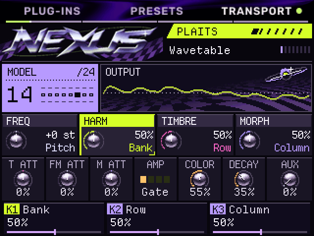
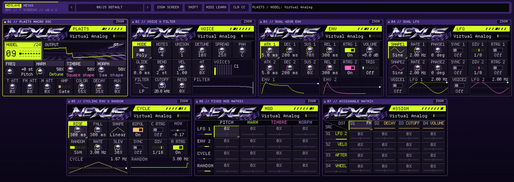
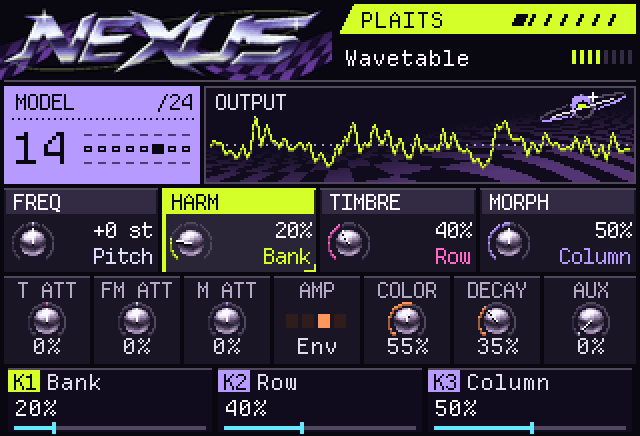

# hdslave Nexus

**An 8-voice polyphonic macro-oscillator synthesizer powered by all 24 Mutable Instruments Plaits models, as a CLAP plug-in for the Akai MPC Sample.**

<table>
  <tr>
    <th width="34%">MPC Sample</th>
    <th width="66%">macOS and Windows · CLAP</th>
  </tr>
  <tr>
    <td align="center"></td>
    <td align="center"></td>
  </tr>
</table>

> **Desktop CLAP version (macOS & Windows):** A separate desktop CLAP build with all MPC screens on one interactive panel lives in [**`mac-clap/`**](mac-clap/) (`cd mac-clap && ./install-macos.sh`). Releases in this repo stay MPC Sample-only for now while the desktop builds are being finalized.

Built for the Akai MPC Sample running [Melodee](https://github.com/keremimo/melodee-sample) / [hdslaveOS](https://github.com/hdslave/hdslaveOS) (64-bit ARM Linux, Cortex-A55). It brings every control of the MPC Plaits plug-in (poloq's VST2) into a native CLAP instrument with seven bespoke, animated screen pages:

- All 24 Plaits macro-oscillator models and their three macros
- Attenuverters and the modelled low-pass gate
- Mono, poly, and legato voice modes with unison, detune, and spread
- Two ADSRs and a retrigger rate
- Two LFOs, a cycling envelope, and a random source
- Multi-mode filter
- Fixed modulation routes and a 4 × 4 assign matrix
- Melodee's Slide and Tie

The synthesis is Plaits' own open-source code (Émilie Gillet, MIT licence): all 24 engines, the internal decay envelope, the low-pass gate, and the output stage run natively at 48 kHz (as on the hardware module) and resample cleanly to the host rate so sound and tuning stay identical at 44.1, 48, or 96 kHz. A transparent soft limiter keeps eight resonant voices cleanly bounded.

Hosts list it as **hdslave Nexus** (id `com.hdslave.nexus`, version 0.1.9). Not yet run on the MPC itself.

## Install

Copy the folder `hdslave Nexus` (the `.clap`, this README and `licenses/`) to `Melodee/Plugins/` on the card. Pick
it on a PLUGIN track (SYNTH on Stage). The custom screen uses `melodee.screen/1` on Melodee 0.7 and hdslaveOS based on it. Open Edit on the plug-in track or select PANEL on Stage.

## Playing it

Use Minus and Plus to move through the seven pages. [Watch the screen tour in Melodee](docs/nexus-pages.gif).

| Page | What it holds |
|---|---|
| MODEL | Model number and bank grid beside the live output scope. FREQ, HARM, TIMBRE and MORPH each show their value, and the three macros show their role in the current model. The bottom row holds T ATT, FM ATT, M ATT, AMP, COLOR, DECAY and AUX. |
| VOICE | MODE, NOTES, UNISON, DETUNE, SPREAD, PAN, GLIDE, BEND, VEL (curve), AT (curve), FILTER, CUTOFF, RESO, VEL>TIM; the eight voices at work and the keys held; the filter's response and where a modulated cutoff is |
| ENV | Env 1 and Env 2 (attack, decay, sustain, release, retrigger), each drawn with where it is now; VOLUME; TRIG (the retrigger rate) |
| LFO | LFO 1 and 2: shape, rate, phase, sync, division, retrigger, per voice; each drawn, moving while it plays |
| CYCLE | the cycling envelope (rise, fall, shape, bipolar, retrigger) and the random source (mode, rate, slew, sync, division, retrigger), drawn and moving |
| MOD | the fixed routes: LFO 1, Env 2, Cycle and Random down; pitch, harmonics, timbre and morph across |
| ASSIGN | the assign matrix: four sources down, four targets across, the sixteen amounts between, each source with its level now |

The wheel moves between controls. Push edits one; turn the wheel to change it (Shift + wheel for fine steps, Minus
and Plus for coarse) and Push again when done. On a switch, Push flips it at once. K1-K3 hold the control picked and
the next two. On MOD and ASSIGN, Shift + Push turns a route on or off; a route that is off shows OFF. Hold Shift to
see the controls. The page draws nothing while nothing changes; while voices sound it moves at 25 frames a second.

## Sound and parameters

**Models** (MODEL, in the module's order): VA VCF, Phase Distortion, 6-Op FM I-III (the module's three factory
banks), Wave Terrain, String Machine, Chiptune; Virtual Analog, Waveshaping, FM 2-Op, Grain Formant, Harmonic,
Wavetable, Chords, Speech; Swarm, Noise, Particle, Inharmonic String, Modal Resonator, Bass Drum, Snare Drum, Hi-Hat.
FREQ transposes by -48 to +48 semitones. OUT/AUX crossfades from the main output to the module's AUX output.

**Attenuverters.** As on the module: while a trigger plays the voice, T ATT, FM ATT and M ATT set how deep its
internal decay envelope moves timbre, pitch and morph (LPG DECAY sets its length). In Drone, FM ATT is a fine tune of
up to a semitone. On Speech they are the module's prosody and speed; on Chiptune, T ATT picks its envelope shape.

**AMP** sets how a note sounds:

| Mode | The note |
|---|---|
| Gate | Opens the low-pass gate while the key is held, closing at LPG DECAY (and COLOR) when it is let go. Velocity opens it less and softens the drum models (the module's accent). |
| Ping | Strikes the gate: it rings out at LPG DECAY whether the key is held or not. Velocity scales the level. |
| Env | Env 1 drives the gate: a full ADSR through the low-pass gate. Velocity scales it. |
| Drone | No gate: Env 1 is a plain VCA. Velocity scales the level. The percussive models play as the module does with nothing in TRIG. |

Models that make their own envelope (6-op FM, the string and modal resonators, the drums) bypass the gate, as on
the module. So does Chiptune in Gate, Ping and Env: T ATT shapes its own envelope, and at 0 a note sounds at full
level, stepping its arpeggio on each strike. The module has nothing that ends such a note. In Nexus each strike opens
it and the gate's fall closes it, at LPG DECAY and COLOR: in Ping from the strike, whether the key is held or not; in
Gate and Env once the key is let go (in Env, following Env 1's release).

**Voices.** Mono plays one note and strikes again on each key. Legato glides from a held key with no new strike.
Poly plays up to NOTES notes. UNISON stacks 1-8 voices on each note, DETUNE spreads them 60 cents apart at full and
SPREAD places them across the stereo field. There are eight voices in all, so NOTES x UNISON beyond eight plays
fewer notes; past NOTES the oldest note lets go. A key played again while it still rings starts its own voice over.
GLIDE (0-2 s, a time constant) slides between overlapping keys in every mode. In Poly, a key let go before it has
played a block (Melodee sends a block's notes together) counts as let go already: it takes no place under NOTES, and
a key struck on that frame does not glide from it. BEND is the pitch-bend range (0-24
semitones). VEL is the velocity curve (an exponent, 0.1-4). AT bends the pressure response (-1 soft to +1 quick).
VEL>TIM (Velocity to Timbre) uses that velocity curve to modulate each note’s timbre. It ranges from −100% to
+100% and defaults to 0%. Positive values raise timbre more for harder hits, and negative values lower it more.
The sustain pedal (CC 64) holds released keys.

**Slide and Tie.** Melodee plays a step's Slide or Tie as CC 84 (the key it comes from) before the next key. The
held voice carries on to the new key with no new strike: Slide glides there over GLIDE (60 ms when GLIDE is 0); Tie
(the legato pedal, CC 68, held over it) jumps at once.

**Envelopes.** Attack, decay and release run 0-5 s; sustain 0-100 %. The attack is an analog-style charge that
reaches full level at the attack time. Decay and release are exponential with their time as the time constant.
RETRIG on restarts the envelope from zero on a new strike; off, it rises from where it is.

**TRIG** (Off, 1/4 to 1/32 with triplets) strikes a held note again at that rate of the song's tempo, counted from
the key. Each strike restarts the envelopes. In Gate, the gate opens for the first half of each step.

**Filter.** A state-variable filter on each voice after the model: LP, BP or HP; CUTOFF 20 Hz-20 kHz; RESO from none
(Q 0.5) to near self-oscillation (Q 20). Fully open, LP with no resonance, it is out of the way.

**VOLUME** is a gain of 0-2 (+6 dB); **PAN** places every voice (unison's spread around it).

**LFOs.** Sine, Triangle, Saw, Square, Random (a new value each cycle) or Smooth (gliding from value to value).
RATE runs 0-40 Hz. SYNC takes the rate from the song's tempo (DIV: 4 bars to 1/32, with triplets) and, while the
song plays and RETRIG is off, locks the phase to the song's position. RETRIG restarts it on each new note (at PHASE; PHASE moves Sine, Triangle, Saw and Square, while Random
and Smooth have no phase to move). VOICE gives each voice its own LFO instead of one for all; a voice's LFO runs from
its own note and does not lock to the song.
Locked to the song, an LFO takes the song's place a little behind the last one it took (by up to a 64th note from where
the last call's frames led, as hdslaveOS judges a jump) as no locate: hdslaveOS works the place out from its ticks, so a swung tick, a tick on a block's edge or MTC's trim puts
it up to 0.0021 of a quarter off from block to block, and a plug-in two tracks play is run twice a block. It holds
where it got to until the song is past it again, so no cycle starts twice. Up to 0.1.8 any step back started a new
cycle: Random drew a new value off its boundary, and the draws went out of step with the song (at 127 BPM with the
place up to 0.002 of a quarter off, 248 of 256 sixteenths held another value than with a straight place). A place
moved back further starts the cycle it lands in, as before.

**Cycle.** A looping rise and fall (each 1 ms to 5 s), Linear, Exp or Log, unipolar (0 to 1) or bipolar (-1 to 1).
RETRIG restarts the rise on each new note.

**Random.** S&H holds a new value at each tick (RATE 0-40 Hz, or SYNC to the tempo at DIV). Smooth glides to each
new value over SLEW's share of the tick (no slew: a step). Drift wanders slowly, about as fast as RATE. RETRIG takes
a new value on each new note.

**Modulation.** The MOD page routes LFO 1, Env 2, Cycle and Random to pitch, harmonics, timbre and morph. The ASSIGN
page routes any four of LFO 1, LFO 2, Env 1, Env 2, Cycle, Random, velocity, aftertouch (polyphonic or channel) and
the mod wheel to any four of pitch, harmonics, timbre, morph, FM (the FM attenuverter), LPG decay, LPG color, cutoff,
resonance, volume, pan and aux mix. Every amount runs -100 % to +100 % on the module's attenuverter curve: fine near
zero, a quarter of the way at 50 %, all of it at the ends. Full depth moves pitch two octaves either way. The other
targets move across their whole range; on volume, full depth goes from silence to +6 dB.

## Presets

Init, Filter Bass, Saw Lead, Square Bass, PD Keys, FM Piano, FM Bells, Terrain Lead, String Ensemble, Chip Arp, Fold
Bass, FM Pluck, Formant Voice, Drawbar Organ, Wavetable Pad, Chord Stab, Speech, Swarm Pad, Noise Sweep, Particle
Drops, Plucked String, Modal Bell, Kick, Snare, Hi-Hat: the factory patches of the MPC Plaits plug-in, value for value,
but for four changed in 0.1.8. FM Bells plays the second 6-op bank's tubular bells (HARMONICS 0.69, MORPH 0.5; its
old values picked a patch that plays an octave below the key). Drawbar Organ plays the Harmonic model's organ output
(AUX), in Drone, an octave down so that the key is the 8' drawbar, with velocity all but flat. String Ensemble plays
octaves on each key (HARMONICS 0.04; at 0.5 each key played a minor ninth chord, which clashed when chords were
played). String Ensemble and Wavetable Pad let go sooner: Env 1's release is 400 and 500 ms (it was 1.4 and 1.8 s,
which rang for 11 and 14 s).
`./build.sh` writes a demo of each to `build/preset-*.wav`.

## How it compares with the plug-in it follows

Nexus was checked against the MPC Plaits plug-in. Both were rendered from the same note scripts at 44.1 kHz and
measured: pitch traces, level envelopes and filter spectra (`tests/render.cpp` renders Nexus from those scripts).

**Measured equal:**
- the tuning
- the modulation depths and the attenuverter curve
- the pressure and velocity curves
- bend and Slide/Tie
- glide
- unison detune and spread
- the four amp modes
- the retrigger rate
- the LFO shapes
- the cycle's shapes
- the filter's cutoff, modes and resonance
- the presets' level (within about a decibel; the four changed in 0.1.8 are Nexus's own)

**Where they differ:**
- That plug-in runs Plaits at the host's rate as if it were 44.1 kHz, so at 48 kHz every note plays 147 cents
  sharp and at 96 kHz more than an octave sharp. Nexus is in tune at any rate.
- Its attack is a slow exponential that does not reach the decay stage when the attack is long (a 300 ms attack is
  still rising after a second). Nexus's reaches full level at the attack time, then decays to sustain.
- Its Smooth random smooths over only about 10 ms, even at full slew; Nexus's glides over Slew's share of each tick.
  Its Drift is very small at low rates; Nexus's wanders about as fast as RATE.
- The shared synced LFOs follow the song's position while it plays (unless RETRIG is on).

## Building and testing

Built and tested in Melodee's build image (Debian bookworm, g++ 12) in the Colima profile `melodee`:

    ./build.sh               # build/Nexus.clap, then the tests and the fingerprint
    ./build.sh sanitize      # the host tests against an AddressSanitizer + UBSan build
    tools/bench.sh           # instructions a block (callgrind): worst, pad, typical, silent, a page frame
                             # (build/bench model:N measures eight voices of model N)
    ./build.sh fingerprint-update   # only after a change meant to change the sound
    ./build.sh render        # build/render: plays a note script (see tests/render.cpp)

- `tests/host.cpp` (354,064 checks):
  - the description and ports
  - every parameter's text both ways, state, presets
  - A4 at 440 Hz at 22.05 to 96 kHz
  - the same output in blocks of 1, 37, 64, 128 and 4096 frames at 44.1 and 48 kHz
  - unison and its detune and spread; the NOTES limit, the eight-voice limit and a key played again
  - Mono, Legato, glide, Slide and Tie
  - MIDI bend, wheel and pressure; the channel modes; chokes and the sustain pedal
  - the modulation depths, the four amp modes and the retrigger rate
  - Chiptune played with a trigger: a key let go goes quiet and frees its voice in Gate, Ping and Env, with TRIG and
    without, Chip Arp and the pedal too; a Ping tap rings as a held key does; a voice used again stays closed until
    its strike; a key pressed again, or MODEL or AMP moved away and back, while a note closes does not open it; the
    same at any block size
  - every model at default and extreme settings, the output within +-1
  - a 6-op FM model taking over from another model: the output stays finite after a sounding Particle voice, and
    the next note is the same, sample for sample, whatever model the voice played before, a 6-op one too; a 6-op
    note choked, silenced or with its model changed under it and back: the next two notes are the same, sample for
    sample, as in an instance that never played
  - edges: values queued over a reset, a key replayed while it rings under NOTES, pedal notes let go before held
    keys, notes shorter than a block, a slide off a pedal-held voice, a glide set with its note, unison raised under
    Mono, the filter coming back in
  - a second review: values queued before a deactivation, the note let go when a chord outruns the voices in
    one block, Reset All Controllers and the pedal, sleeping in small host blocks, a key replayed after unison was
    lowered, note-offs by CLAP note id, NOTES 2 holding two of four keys struck on one frame
  - a third review: the output within +-1 and untouched below about -2 dBFS, a held note's id still known after 32 more
    notes, chokes and All Sound Off fading within a block instead of stepping
  - sleeping when silent
  - a Random LFO locked to the song's sixteenths: the same value on each as with a straight place, with the place up
    to 0.002 of a quarter off (also in parts), swing 60's ticks and run twice a block, at 127 and 40 BPM; a place
    moved back under a 64th note held, over it a new cycle
  - the page (its pictures in `build/`)
  - no hardware names in what a player reads; the reported delay against rendered onsets; a flood past the event
    queue sounding the same at any block size; states claiming another version refused
- `tests/fingerprint.cpp`: a hash of every output sample over 67 scenarios: each preset and each model, the voice
  modes, Slide and Tie, the modulators, the filters, held Chiptune notes (recorded from 0.1.7), three other rates
  and four block sizes.
- In Melodee's own host: `clap_check` (loads and plays it as Melodee does) and `melodee --melodee-plugin-screen`
  (its page in Melodee's screen, the K1-K3 bindings).

**Cost.** Measured with callgrind, in 128-frame blocks at 48 kHz. A block is about 4.8 million cycles on the MPC's
1.8 GHz A55.

| Case | Instructions a block |
|---|---|
| Worst: eight 6-op FM voices, every route on, a resonant filter | 589,000 (about 12 % of one core) |
| Pad: the Wavetable Pad, four notes | 239,600 |
| Typical: the Saw Lead playing a line | 116,400 |
| Silent | 10,500 |

Eight voices of one model (eight keys held, `bench model:N`) cost from about 225,000 instructions a block (Chiptune,
Speech: 4.7 % of a core) to 620,000 (Particle: 12.9 %); most models sit between 7 and 12 %.

At other host rates the resampler adds a little: the pad costs 97 million instructions a second at 44.1 kHz (Melodee's
default) against 91 million at 48 kHz, where samples pass as they are. Silent, the resampler skips its work.

The MODEL page averaged about 100,000 instructions per painted frame in the four-second pad benchmark. Silent voices cost nothing. When everything is silent,
the plug-in tells the host it may sleep.

**Delay and tail.** A note sounds after a fixed delay the plug-in reports to the host: 83 samples at 44.1 kHz, 71 at
48 kHz, 176 at 96 kHz (the resampler's reach, the module's four-block trigger delay and up to one 12-sample tick,
measured against rendered onsets). The reported tail is unbounded: at their longest, a modal resonator rings past
200 seconds, an envelope release past 57 seconds, and an inharmonic string still sounds minutes after its key.

## Licence

No project licence yet for Nexus's own code. The Plaits and stmlib code is MIT (Emilie Gillet,
`licenses/LICENSE-MIT-mutable-instruments.txt`; changes listed in `third_party/eurorack/NOTES.md`). The page's
font is Departure Mono (SIL Open Font License, `licenses/OFL-departure-mono.txt`). The CLAP headers are MIT
(`third_party/clap/LICENSE`), and `src/melodee_screen.h` is MIT. See `THIRD_PARTY.md`.

"Plaits" and "Mutable Instruments" name where the code comes from. Nexus is not made or endorsed by Mutable
Instruments or by the author of the MPC Plaits plug-in.
