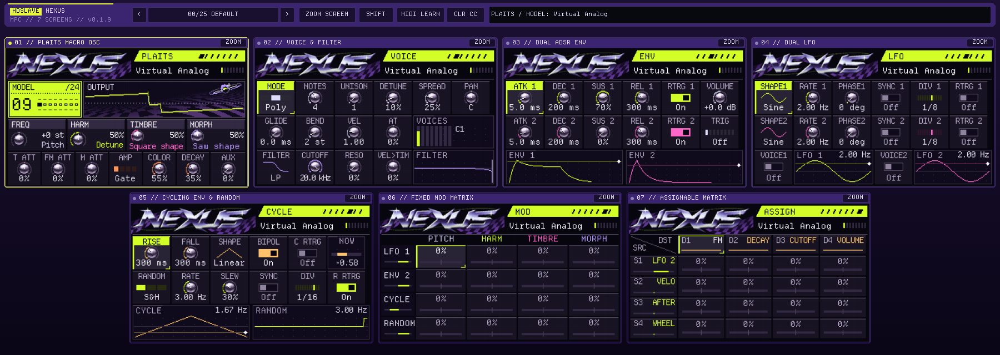

# hdslave Nexus — macOS (and Windows) Desktop CLAP Plug-in

Separate desktop CLAP build of **hdslave Nexus** for **FL Studio** (2024+) and any other CLAP host on macOS (Apple Silicon / Intel) and Windows (x64).



- **Multi-Screen MPC Dashboard:** displays all of hdslave Nexus's native MPC screens simultaneously on one resizable Retina/HiDPI panel (with the hardware `K1`–`K3` footer panels removed) and direct mouse, trackpad, and touch control over every parameter, plot, sequencer, and pad.
- **Standalone from the MPC Sample build:** this directory is completely separate from the MPC Sample build in the repository root (`../src`, `../build.sh`). GitHub releases remain MPC Sample-only for now while the desktop builds are being finalized.

**Velocity to Timbre** is on the **Voice & Filter** tile as **VEL>TIM** in version 0.1.4. Drag the control to set the signed amount. It starts at 0%.

## Build & Install (macOS)

Requires Xcode Command Line Tools and CMake 3.20+ (Ninja optional):

```bash
cd mac-clap
./build-macos.sh
./install-macos.sh
```

`install-macos.sh` builds, ad-hoc signs, tests, and installs `Nexus.clap` to `/Library/Audio/Plug-Ins/CLAP/` (pass `--user` to install to `~/Library/Audio/Plug-Ins/CLAP/`). Quit and reopen FL Studio after reinstalling so macOS reloads the updated bundle.

## Build (Windows x64)

```powershell
cd mac-clap
.\build-windows.ps1
```

Copy `build\windows\clap\Release\Nexus.clap` to `C:\Program Files\Common Files\CLAP\`.
